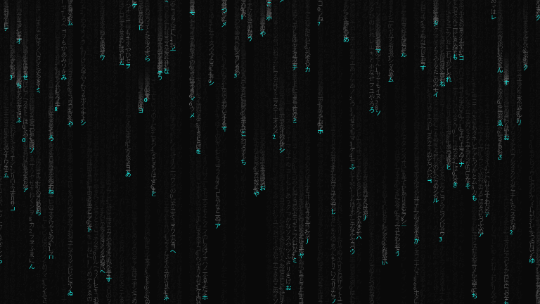
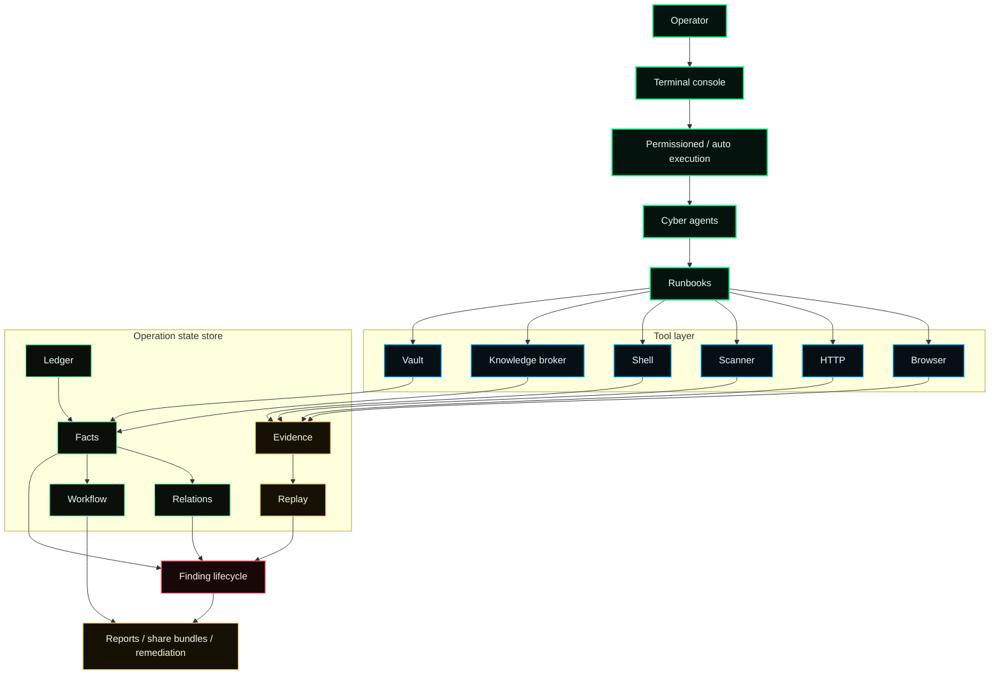
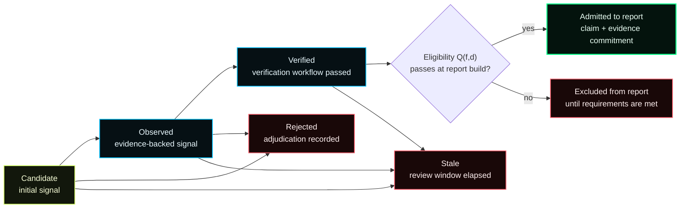

<h1 align="center">AEGISEC</h1>

<p align="center">
  <sub>Developed by <b>Kranthi Yelaboina</b></sub>
</p>

<p align="center">
  <b>The open-source AI security agent with evidence-gated reporting.</b>
</p>

<p align="center">
  Give your terminal a security brain.
</p>

<p align="center">
  Run security workflows with your local tools, agents, runbooks, findings, evidence, replay and reports.
</p>

<p align="center">
  <code>npm install -g aegisec</code>
</p>

<p align="center">
  <a href="https://github.com/kranthiyelaboina/AEGISEC/actions/workflows/ci.yml"></a>
  <a href="https://github.com/kranthiyelaboina/AEGISEC/releases"></a>
  <a href="https://www.npmjs.com/package/aegisec"></a>
  <a href="https://www.npmjs.com/package/aegisec"></a>
  <a href="https://github.com/kranthiyelaboina/AEGISEC/stargazers"></a>
  <a href="LICENSE"></a>
</p>

<p align="center">
  
</p>

<p align="center">
  <a href="#why-aegisec">Why</a> |
  <a href="#what-it-feels-like">What it feels like</a> |
  <a href="#try-it">Try it</a> |
  <a href="#what-it-does">What it does</a> |
  <a href="#evidence-gated-reporting">Evidence gate</a> |
  <a href="#research-evaluation">Research</a> |
  <a href="#commands">Commands</a> |
  <a href="#architecture">Architecture</a> |
  <a href="#roadmap">Roadmap</a>
</p>

---

## What is aegisec?

aegisec is an operator-supervised AI security agent and evidence-gated reporting layer that runs in your terminal.

It coordinates local tools and runbooks, maintains operation context, records observations and evidence, tracks a finding's lifecycle, and helps produce reviewable reports. The accompanying research focuses on one specific assurance mechanism: a finding is admitted to a generated report only when it is verified, has retained evidence, and has replay support or a valid domain-specific exemption.

In that research framing, AEGISEC complements scanners and investigation agents. It does not claim that generated text is proof, that the reporting gate discovers more vulnerabilities by itself, or that it replaces established tools.

- Not just a chatbot.
- Not a replacement for specialised scanners or tools.
- Not a Burp Suite or Kali replacement.

A security workflow for the tools you already use.

## Why aegisec

Security work does not happen in one clean place.

You move between terminal commands, browser work, HTTP requests, local tools, scanners, advisories, notes, screenshots, findings and reports.

AI can help, but only if it lives inside that workflow.

aegisec gives the model a security workspace instead of just a chat box. It keeps the target, scope, tools, runbooks, findings, evidence, replay and report state together while the work is happening.

The goal is simple:

**make security work feel faster, sharper and less scattered.**

aegisec is strongest today for authorized AppSec and Pentest workflows. Other cyber surfaces exist or are possible, but they are not marketed as equally mature yet.

## Why now

Coding agents changed how developers work.

They read code, run commands, edit files, execute tests and stay inside the development loop.

Security needs the same shift, but security work has different constraints.

A security agent needs to know the target, stay inside scope, use the local toolchain, remember what happened, separate noise from findings and keep enough context to produce useful output later.

That is what aegisec is trying to become:

**the open source AI security agent for the terminal.**

## What it feels like

Open aegisec inside the workspace you are testing, pick the right security agent, check which local tools are available, then start a runbook and let the agent help you move through the workflow.

When the work changes, switch posture. When something matters, keep the finding, evidence, replay and report context close to the operation instead of scattering it across shell history, screenshots and notes.

Then come back later and resume without starting from zero.

<p align="center">
  <a href="https://github.com/kranthiyelaboina/AEGISEC/blob/main/assets/aegisec.png">
    
  </a>
</p>

<p align="center">
  <sub>Startup and session-continuation view from a local terminal run.</sub>
</p>

## Product tour

aegisec starts like a terminal agent, then the security work begins, and it becomes a workspace.

You get the model, the active agent, the command palette, the working directory and the prompt. The point is not to leave your terminal; the point is to make the terminal smarter.

Findings are not dumped into chat: they live in the operation, where each one can carry lifecycle state, severity, evidence, replay status and next action. Report admission is checked separately at build time; evidence and replay support do not guarantee that a claim is semantically correct.

Weak signals can stay weak. Rejected claims remain visible. Reportable findings need proof.

Security work changes shape. AppSec, Pentest, OSINT, CTF/lab and research do not need the same posture, so you can switch the agent when the work changes instead of forcing one generic assistant to behave the same way everywhere.

Operations are durable. Name them, rename them, resume them and export them. A security workflow should not disappear because the chat ended.

## Try it

```bash
npm install -g aegisec
aegisec
```

Then start with a local lab, CTF, owned app or authorized target:

```text
/doctor
/mode appsec
/runbook run appsec-web-triage http://localhost:3000
/share
```

Run aegisec from the workspace you are testing and keep the target scope explicit.

## What it does

| Capability | What it gives you |
|---|---|
| **AI security agent** | A model that works inside your terminal instead of sitting in a separate chat window. |
| **Local tools** | aegisec uses the tools installed on your machine and shows what is available, missing or degraded. |
| **Runbooks** | Security workflows that keep the agent moving through a real task instead of random tool calls. |
| **Agents** | Switch posture with TAB for AppSec, Pentest, OSINT, CTF/lab and research-style work. |
| **Operation memory** | Keep target, scope, activity, findings, evidence, replay and report state together. |
| **Findings workflow** | Track security signals as they move from weak ideas to useful findings. |
| **Evidence and replay** | Keep the material needed to understand, verify and reproduce important work. |
| **Cyber knowledge** | Bring vulnerability intelligence, advisories, methodology and tool docs into the workflow. |
| **Reports** | Generate deliverables from the operation instead of reconstructing everything at the end. |
| **Share bundles** | Export the work so it can be reviewed, resumed or handed off. |

## Evidence-gated reporting

The report gate is the central assurance mechanism evaluated in the accompanying paper. It treats report admission as a build-time decision, not as a property of confident-sounding model output.

For a finding to be eligible for a report, the evaluated rule requires all three conditions:

1. **Verified lifecycle state** — the verification workflow has passed.
2. **Retained evidence** — at least one evidence reference is linked to the finding and its stored bytes pass digest validation.
3. **Replay or exemption** — replay material is available, or a valid domain-specific replay exemption has been recorded.

At report-build time, the predicate is re-evaluated. The report then carries a SHA-256-based Merkle commitment over each admitted finding’s canonical claim text, linked evidence digests, verification status and timestamp, and replay outcome or exemption record. This is intended to make post-generation changes to committed content detectable when compared with the recorded root.

The boundary matters: the gate checks **structural support and workflow eligibility**, not whether a finding is semantically correct. A claim can have evidence and successful replay yet still be mis-scoped or misinterpreted. The Merkle root also does not by itself prevent a party controlling both the report and its root from replacing both. Human review remains necessary for relevance, impact, remediation priority and disclosure decisions.

<p align="center">
  <a href="https://github.com/kranthiyelaboina/AEGISEC/blob/main/assets/aegisec%203.png">
    
  </a>
</p>

<p align="center">
  <sub>Example operation-workspace view. This is an interface illustration; the quantitative results below come from the separately described labelled benchmark fixtures.</sub>
</p>

## Research evaluation

The accompanying paper, **“AEGISEC: An Automated Penetration Testing Framework with Evidence-Gated Reporting,”** evaluates the reporting gate separately from raw scanner discovery. Its headline results are specific to the labelled fixtures, tool versions and repeated-run protocol below; they are not performance guarantees for arbitrary applications.

| Evaluation | Setup | Reported result |
|---|---|---|
| AEGISEC, gate disabled vs. enabled | OWASP Juice Shop v20.2.0; 80 labelled cases (40 vulnerable and 40 negative controls); five fresh-instance runs | Mean precision increased from **73.0% to 92.0%**; false-positive rate fell from **25.0% to 5.0%**; mean recall fell from **67.5% to 57.5%**. |
| OWASP ZAP with the same gate | ZAP 2.16.0; same Juice Shop benchmark and five-run protocol | Mean precision increased from **68.8% to 84.3%** after its alert stream passed through the gate. |
| Nuclei baseline | Nuclei 3.3.7; same Juice Shop benchmark | Mean precision was **87.1%** and mean recall was **54.0%** for the evaluated template set. |
| Cross-fixture replication | bWAPP; 40 labelled cases (20 vulnerable and 20 negative controls); five runs | AEGISEC precision increased from **77.9% to 91.5%**, while mean recall fell from **74.0% to 64.0%**. |

The 10-percentage-point recall reduction on Juice Shop is an explicit trade-off, not a free improvement: the gate blocked four of 40 known vulnerable cases per run in that setup. The paper also reports a 24-test conformance suite that rejected injected invariant violations. That is implementation-level conformance testing, **not** a machine-checked proof that the invariants hold for every possible execution.

A separate authorised production case study reports 13 adjudicated candidates (9 verified and 4 rejected), 6 categories, 20 reportable instances and 12 retained evidence items. It is a single retrospective case study, not a representative sample from which general detection rates can be inferred. The benchmark is also limited to one Juice Shop release and one bWAPP configuration; independent labelling and broader fixtures remain future work.

## Built for

aegisec is for people who want an AI agent inside their security workflow, not beside it.

- **AppSec engineers** triaging web apps, APIs, dependencies, auth flows and reports.
- **Pentesters** moving through scoped work with terminal tools, notes, evidence and deliverables.
- **Bug bounty hunters** who want to move faster without losing target context.
- **Security researchers** jumping between shell, browser, HTTP, advisories, tradecraft and notes.
- **CTF and lab users** who want structure while still keeping direct control of the tools.

aegisec is for authorized security work. Use it only on systems you own, labs, CTFs, or targets where you have permission to test. Scope controls are safety aids, not substitutes for written authorization, an agreed test window or operator judgment.

## How the workflow fits together

aegisec is not just a prompt with tools.

It keeps the security workflow connected: target, operation, posture, runbook, local tools, observations, findings, evidence, replay and report.

```mermaid
flowchart LR
  target["Target"] --> operation["Operation"]
  operation --> posture["Scope + opsec + autonomy"]
  posture --> runbook["Runbook"]
  runbook --> tools["Local cyber tools"]

  tools --> evidence["Evidence"]
  evidence --> observations["Observations"]
  observations --> findings["Findings"]
  findings --> proof["Replay / proof"]
  proof --> report["Report"]

  operation -. source of truth .-> kernel["Operation state store"]
  kernel --> evidence
  kernel --> findings
  kernel --> report

  classDef primary fill:#04130d,stroke:#00ff88,color:#eafff4,stroke-width:2px;
  classDef secondary fill:#061014,stroke:#00c2ff,color:#eaf9ff,stroke-width:1.5px;
  classDef proofNode fill:#151104,stroke:#ffcc66,color:#fff7df,stroke-width:1.5px;
  classDef findingNode fill:#190808,stroke:#ff5f6d,color:#fff0f0,stroke-width:1.5px;

  class target,operation,posture,runbook,tools primary;
  class evidence,observations,kernel secondary;
  class proof,report proofNode;
  class findings findingNode;
```



The important part: the operation does not live only in chat. aegisec keeps a durable record of the work so the agent can continue, the operator can review, and the report can be assembled from retained operation state. The evidence gate limits what is admitted, but it does not replace human assessment of the claim.

## How aegisec is different

Most AI security tools fall into one of two traps: they only talk, or they only wrap tools. aegisec tries to do something different: keep the workflow alive while the agent works.

| Compared with | What usually happens | What aegisec does |
|---|---|---|
| **Generic AI chats** | Good advice, but detached from the actual work. | Runs inside the terminal workflow with tools, memory and operation state. |
| **Generic coding agents** | Great for repos and tests, but not shaped around security work. | Adds security agents, runbooks, scope, findings, evidence, replay and reports. |
| **Scanner wrappers** | Fast output, weak context. | Turns tool output into part of a larger operation. |
| **Manual notes** | Flexible, but everything drifts apart. | Keeps findings, evidence, replay and reports connected. |
| **Tool servers** | Expose capabilities, but leave workflow and memory to the user. | Adds the security workflow around the tools. |

## Commands

aegisec is designed to stay fast from the keyboard: start an operation, switch agents, run workflows, inspect tools, tighten opsec, export the work and come back later.

```text
/doctor                        inspect local tool readiness
/mode appsec                   switch to the AppSec agent
/mode pentest                  switch to the Pentest agent
/agents                        open the agent switcher
/runbook list                  show available security workflows
/runbook run appsec-web-triage <target>
/runbook run web-surface <target>
/operations                    inspect, rename, resume or switch operations
/opsec strict                  tighten operation boundaries
/models                        switch provider or model
/share                         export the active operation bundle
/remediate <observation_id>    turn an observation into remediation guidance
/pwn <target>                  create a scoped pentest operation for a target
```

## Install

### npm

```bash
npm install -g aegisec
aegisec
```

### Bun

```bash
bun add -g aegisec
aegisec
```

### Docker

```bash
docker run -it --rm -v "$PWD:/work" -w /work kranthiyelaboina/AEGISEC:latest
```

### From source

```bash
git clone https://github.com/kranthiyelaboina/AEGISEC.git
cd aegisec
bun install
cd packages/aegisec
bun run build
```

## Tool surface

aegisec does not try to replace your tools.

It gives the agent a controlled way to use and reason around the environment you already have: shell, files, browser, HTTP, scanners, evidence, reports, knowledge and workspace state.

The agent sees a small set of useful security surfaces:

- **terminal and files:** `bash`, `read`, `write`, `edit`, `apply_patch`, `grep`, `glob`
- **web and application testing:** `http_request`, `browser`, `scanner`, `appsec_probe`
- **operation control:** `runbook`, `pwn_bootstrap`, `scope`, `opsec`, `autonomy`, `identity`
- **proof workflow:** `evidence`, `observation`, `finding`, `report`, `share`, `remediate`
- **security intelligence:** `knowledge`, `methodology`, `cve`
- **environment:** `doctor`, `workspace`, `vault`, `net`, `crypto`, `analyze`

`knowledge` is the preferred cyber research surface. It routes vulnerability intelligence, package advisories, methodology, tradecraft, exploit signals and installed tool docs through one provenance-aware broker.

For observed components like `nginx 1.18.0`, `OpenSSH_8.2p1` or `npm:react@18.2.0`, it separates **possibility** from **applicability**, enriches with KEV/EPSS where available, and suggests safe next actions without turning intelligence into a finding.

`cve` remains as a compatibility alias for CVE-style lookup. New cyber research should use `knowledge`.

Local tools make aegisec stronger. If these are installed, the agent can use or reason around them:

```bash
# Debian / Kali / Ubuntu
apt install nmap sqlmap ffuf gobuster nikto nuclei trivy checksec commix wafw00f feroxbuster

# macOS
brew install nmap sqlmap ffuf gobuster nikto nuclei trivy checksec
```

Optional extras the agent will pick up when present:

```bash
pipx install frida-tools          # dynamic instrumentation (frida, frida-trace)
go install github.com/hahwul/dalfox/v2@latest   # XSS scanner (or download a release binary)
bun add -g xxexploiter            # XXE payload generator (or npm i -g xxexploiter)
git clone --depth 1 https://github.com/swisskyrepo/SSRFmap ~/.local/share/aegisec-tools/SSRFmap
printf '#!/bin/sh\nexec python3 "$HOME/.local/share/aegisec-tools/SSRFmap/ssrfmap.py" "$@"\n' \
  > ~/.local/bin/ssrfmap && chmod +x ~/.local/bin/ssrfmap
git clone --depth 1 https://github.com/lijiejie/GitHack.git ~/.local/share/aegisec-tools/GitHack
printf '#!/bin/sh\nexec python3 "$HOME/.local/share/aegisec-tools/GitHack/GitHack.py" "$@"\n' \
  > ~/.local/bin/githack && chmod +x ~/.local/bin/githack
```

Use `/doctor` to see what is available, degraded, or missing on the current machine.

## Models and providers

Bring the model you trust. aegisec is model-agnostic and wraps the model you choose with a security workflow: terminal, tools, agents, runbooks, operation memory, findings, evidence and reports.

Supported provider families include OpenAI, Anthropic, Google, xAI, Bedrock, OpenRouter, Ollama, Vercel AI Gateway, OpenAI-compatible endpoints, and other providers supported through the local model stack.

The bet is not that one model magically solves security. The bet is that good models become much more useful when they work inside the right security environment.

## Architecture

aegisec wraps the model with a security workflow. The model can reason and act; aegisec keeps the operation around it: tools, runbooks, events, facts, evidence, replay, findings and deliverables. The operation kernel described here is an application-level store, not a privileged OS kernel.



### Operation memory

An operation is stored as events, facts, relations, evidence, replay artifacts, workflow state and deliverables. The operation kernel is an **application-level state store**, not a privileged operating-system kernel.

`aegisec.md` can exist as a derived context pack. It helps orient the model, but it is not the source of truth.

### Finding lifecycle

Security work has messy intermediate states. Something can look interesting without being true. Something can be observed without being ready for a report. Something can be verified and later become stale.

aegisec keeps those states visible instead of flattening everything into chat output. In the research model, **reportability is not a separate lifecycle state**: the report builder re-evaluates the eligibility predicate against the current verified finding and its retained support.



The model is allowed to explore. The workflow is not allowed to pretend every idea is a finding.

### Runbooks instead of random tool spam

Security agents get noisy when they can call tools without a workflow. aegisec uses runbooks to keep the agent moving through a recognizable task shape: surface mapping, AppSec triage, scoped pentest work and future domain-specific workflows.

Strongest today:

- `appsec-web-triage`
- `web-surface`
- `pwn` / Pentest starter flow

Maturity-labeled surfaces:

- repository AppSec triage
- API and auth surface work
- network surface work
- OSINT target work
- CTF and lab workflows
- cloud, container, IaC and binary triage

## Built to avoid AI security slop

aegisec is built around a simple rule: **the agent can help you move faster, but the workflow should not let it overclaim.**

That is why aegisec tracks scope, operation state, findings, evidence, replay and report output.

Mature focus:

- AppSec
- Pentest

Other cyber surfaces exist or are planned, but they are not marketed as equally mature yet.

aegisec does not claim to replace authorization, operator judgment, manual review or specialized tools.

That honesty is not marketing modesty. It is part of the product. Security tools lose trust when they confuse confidence with proof.

## Roadmap

The long-term vision is simple:

**an open source AI security agent that can grow with the community.**

Short term, aegisec is staying focused:

- better AppSec workflows
- better Pentest workflows
- stronger local tool adapters
- better evidence and replay capture
- cleaner report generation
- more useful agents
- better operation sharing
- clearer maturity labels

Longer term:

- OSINT workflows with provenance
- CTF and lab workflows
- cloud, container and IaC triage
- team operations
- review and handoff
- richer knowledge packs
- community runbooks

The rule stays the same: every mature domain needs real workflow support, not just a prompt.

## Documentation

- [Operations](docs/OPERATIONS.md)
- [Tool reference](docs/TOOLS.md)
- [Operation file format](docs/AEGISEC_FILE_FORMAT.md)
- [Documentation](documentation.txt)
- [Changelog](CHANGELOG.md)
- [Contributing](CONTRIBUTING.md)
- [Security](SECURITY.md)

## Development

```bash
bun install
bun typecheck

cd packages/aegisec
bun test --timeout 30000
bun run build
```

AppSec and Pentest benchmarks are local/manual release-confidence tools:

```bash
cd packages/aegisec
bun run bench:cyber --domain appsec
bun run bench:cyber --domain pentest
```

Do not run package tests from the repo root. aegisec uses Bun-first package-local workflows.

## Contributing

The most valuable contributions make aegisec a better operator:

- runbooks with clear scope and proof semantics;
- parsers that turn tool output into provenance-backed facts;
- adapters for real security tools;
- benchmark scenarios that are hard to fake;
- report templates that reduce overclaiming;
- TUI polish that makes operations easier to read under pressure.

If a change creates a confirmed security claim, it needs retained evidence. Under the evaluated report rule, an admitted finding must be verified, link to evidence, and have replay support or a valid structured exemption.

## Community

The best feedback is not "cool project".

The best feedback is:

- I tried it on this kind of authorized workflow
- this part made me faster
- this part got in my way
- this tool should be better supported
- this runbook should exist
- this finding flow felt wrong
- this report output was useful or useless

Use GitHub issues and discussions for bugs, workflow feedback, runbook ideas, adapters and release questions.

Please keep examples authorized, lab-based or safely anonymized.

## Help shape aegisec

aegisec is early, but the direction is clear:

**make security work feel faster, sharper and less scattered with an AI agent that lives in the terminal.**

If that feels useful, star the repo, try it on an authorized workflow and tell me where it breaks.

## License

[GNU Affero General Public License v3.0 or later](./LICENSE). Use aegisec for authorized security work, research, education, and defensive operations.

<p align="center">
  Built and maintained by <b>Kranthi Yelaboina</b>
  <br/><sub>If aegisec helps you, <a href="https://github.com/kranthiyelaboina/AEGISEC/stargazers">drop a star</a> and share the workflow.</sub>
</p>
